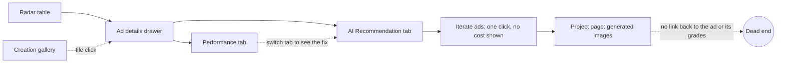
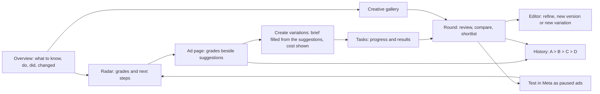

# Figma annotation bank (EN + 简体中文)

Written by Claude on `feat/architecture-and-data`, Nov 21. Source for the Figma frames: flows, glossary, roadmap and the numbered annotations 01 to 18 (numbers match `handoffs/execution-plan.md` and never change). Rule IDs (R-…) point to `handoffs/ui-research-spec.md`; decision IDs (DL-…) point to its section 14.

Where the plan and a later decision differ, this file follows the decision: grades stay (DL-01), the switch stays "Overview" and "Radar" (DL-02), dates are month first (DL-03), the UI says "variation" and "version" (DL-07).

## 1. Old vs new user flow

### Old: the loop breaks in three places

| # | Break | 断点 |
|---|---|---|
| 1 | The reading (Performance) and the fix (AI Recommendation) sit on two tabs | 诊断与建议分在两个标签页，需要来回切换 |
| 2 | Generated images live in a project with no path back to the ad's results | 生成的素材与原广告的表现数据脱节 |
| 3 | A tile in Creation throws you into Analytics | 在「创作」中点击素材会被带回「分析」 |

### New: one loop, three places with one job each

| Place | Job | 定位 |
|---|---|---|
| Overview | Daily triage: four questions | 每日速览：四个问题 |
| Radar and ad page (Analytics) | Diagnose: why a grade is what it is, and what to fix | 诊断：评级原因与修复方向 |
| Creation | Act: make, review and refine variations without leaving | 执行：生成、筛选、优化变体，全程不跳出 |

## 2. Terminology glossary

| Term in the UI | Meaning | Concept name for Figma | 中文 | Note |
|---|---|---|---|---|
| Ad | What runs and has results | Ad | 广告 | |
| Copy | One running instance of an ad in a campaign and ad set | Copy | 投放副本 | Never used for ad text; ad text is "text" |
| Creative | The image or video itself | Creative | 素材 | |
| Grade | A to D per metric, plus an overall grade, each with a plain-word band (Top, Above average, Below average, Lowest) | Grade | 评级 | Kept: it is Atria's own term (DL-01). "Creative health tier" (创意健康度等级) is a roadmap test, not a rename |
| Suggestion | A fix Atria proposes for one metric | Suggestion | 建议 | Atria's help center says "recommendation"; open for Atria to align |
| Variation | A new creative made from an ad to test one idea | **Iteration (迭代)** = a round of variations aimed at one metric | 变体 | The UI never says "iterate" |
| Version | An edit of the same variation (v1, v2) | **Revision (修订)** = a tactical tweak inside the same idea | 版本 | |
| Round | One batch of variations | Round | 轮次 | |
| History | The chain A > B > C > D of live ads made from one another | Lineage | 迭代历史 | |

## 3. Roadmap (impact vs effort)

| Phase | What | Impact | Effort | Graduates when |
|---|---|---|---|---|
| **1. Quick wins (in the prototype)** | Creation keeps its own routes (01, 18). Grades beside suggestions on one page (02). Suggestions in four parts (04). Overview as four questions (15). Grade popover hierarchy (07). Ad summary layout (08). Brief filled from the suggestions (09). Feedback separated from Download (10). CTR banner (12). Sliding switch (13). Phone cards, compact tags, bottom sheets (05, 06) | High | Low | People get from triage to a new round in 3 clicks or fewer, and nobody lands in Analytics from Creation by accident |
| **2. Core builds (weeks 2 to 4)** | History with change summaries and repeat warnings on live data (16, 17). Reference strip with short write-ups (03). Stylized text kept in sync with the editable text (11). Radar settings back (metric, default period) | High | Medium | Teams can name what changed between any two ads in a chain, and repeated tests drop by 25% or more |
| **3. Stretch (next quarter on)** | Fatigue warnings before results drop. Variations across platforms with publishing. Approvals on phones. Test "creative health tiers" against letter grades (14) | Medium to high | High | Measured lift in results per credit spent |

第一阶段：原型中已实现的快速优化。第二阶段（第 2 至 4 周）：迭代历史、参考素材、风格化文字同步。第三阶段（下季度起）：素材疲劳预警、跨平台生成与发布、移动端审批、健康度等级测试。

## 4. Screen annotations 01 to 18

Card format for Figma: pin number, then Problem and Decision in both languages, then the rule or decision ID. Keep each card to these lines.

| # | Screen | [EN] Problem | [EN] Decision | [简体中文] 问题 | [简体中文] 设计决策 | Ref |
|---|---|---|---|---|---|---|
| 01 | Creative gallery | Clicking a tile in Creation opened the ad page in Analytics, so people lost their place | Tiles open the round inside Creation. "View in Radar" is a separate, explicit link | 在「创作」中点击素材会跳转到「分析」的广告页，用户丢失上下文 | 素材在「创作」内打开对应轮次；「在 Radar 中查看」作为单独入口 | DL-06, R-P |
| 02 | Ad page | The original split Performance and AI Recommendation into two tabs | One page: grades and numbers at the top, suggestions right below, each tied to the grade it fixes. Seeing the cause beside the fix beats switching tabs | 原版把「表现」和「AI 建议」拆成两个标签页 | 合并为一页：上方是评级与数据，下方是建议，每条建议对应它要改善的评级，原因与方案一眼可见 | R-H, R-I |
| 03 | Round page, Create panel | The original showed reference images with a write-up; ours dropped them | A short reference strip: thumbnail plus a two-line note on why it works. Phase 2 for curated content; the prototype shows each angle's reason | 原版有带说明的参考素材，新版缺失 | 增加参考素材条：缩略图加两行「为什么有效」。精选内容放在第二阶段，原型先展示每个角度的理由 | R-E |
| 04 | Ad page, suggestion card | Suggestions lost their structure | Four parts in a fixed order: what's happening, the number behind it, what to change, add to brief | 建议卡片失去了清晰的结构 | 固定四段：现象、数据依据、修改方向、加入简报 | R-H, R-I |
| 05 | Phone: dates and goal tags | Long date ranges and goal tags wrapped or overflowed | Short forms below 768 px ("Sep 21 to Nov 19", goal name only), extra tags fold into "+2", nothing breaks mid-phrase | 移动端日期范围和目标标签过长，换行或溢出 | 768px 以下使用短格式，多余标签收进「+2」，不在词组中间断行 | DL-03, R-L, R-R |
| 06 | Phone layout | Phones showed a shrunken desktop. People use phones to check and approve, desktops to analyze and create | Phones: summary cards, one main action, bottom sheets, sticky action bar. Desktop: full tables and side-by-side views | 移动端只是桌面端的缩小版，但两者的使用场景不同 | 移动端：摘要卡片、单一主操作、底部弹层、固定操作栏，用于快速查看与确认；桌面端：完整表格与并排视图，用于深度分析与创作 | R-R, R-H |
| 07 | Grade popover | All lines looked the same weight, including the last two | Three levels: grade and band, the numbers, then a muted footer for the period and the video-only note | 评级浮层信息层级扁平，最后两行尤其混淆 | 三层结构：评级与档位、数据明细、弱化的页脚（统计周期与说明） | R-H, R-C |
| 08 | Ad summary card | Summary, goal tag, grades and numbers competed in one block | Three zones: creative and type, the reading with grades and three numbers, then the action | 广告摘要卡片内容拥挤，缺少浏览顺序 | 三个区域：素材与类型、结论加评级与三项数据、操作按钮 | R-H |
| 09 | Create variations panel | The panel started with an empty brief | "Start from the suggestions" fills in product, audience, goal and what to change. Every line stays editable | 生成变体时简报为空，需要从头填写 | 新增「从建议开始」：自动填入产品、受众、目标与修改方向，所有内容可编辑 | R-AI, R-E |
| 10 | Editor header | Thumbs up and down sat beside Download, mixing feedback with file actions | Feedback moves next to the image it rates; Download and Delete stay in the top-right toolbar | 点赞、点踩与下载按钮并排，评价与文件操作混在一起 | 评价移到所评图片旁；下载和删除留在右上角工具栏 | R-I, R-H |
| 11 | Editor, Text block | Stylized text was offered on two images only | Every variation with text offers "Stylized text"; the model draws the text into the image, with a clear note that it can misspell | 风格化文字只在两张图上可用 | 所有带文字的变体都提供「风格化文字」，由模型把文字画进图片，并提示可能出现拼写错误 | R-AI |
| 12 | Editor header | The key finding ("CTR D · Nothing stops the scroll") was squeezed into one small line | A banner under the title: the metric with its grade tag, then the full sentence, never cut | 关键诊断挤在一行小字里，容易被忽略 | 标题下方用横幅展示：指标加评级标签，完整说明不截断 | DL-05, R-L |
| 13 | Top bar switch | The Overview and Radar switch looked flat and its role was unclear | A sliding pill: the active side moves, labels stay "Overview" and "Radar" | 「Overview / Radar」切换控件不够清晰 | 改为滑动胶囊样式，名称保持不变 | DL-02, R-MO |
| 14 | Grades (terminology) | Letter grades can read as school marks | Keep Atria's grades, and always pair the letter with a plain-word band and the number behind it. Tiers are a roadmap test | 字母评级可能让人联想到学校成绩 | 保留 Atria 的评级体系，字母始终搭配文字档位和具体数据；「健康度等级」列入路线图测试 | DL-01, R-T |
| 15 | Overview | Section titles named data, not what people want to know | Four sections: What to know now, What to do next, What you did, What changed | 概览页的分区标题以数据命名，没有回应用户的问题 | 四个分区：现在要知道什么、下一步做什么、我做过什么、有什么变化 | R-P, R-H |
| 16 | History (lineage) | No way to trace how an ad became what it is | A chain A > B > C > D. Each step shows the date, placement, grade and the result against its parent | 无法追溯一条广告是如何一步步迭代来的 | 用 A > B > C > D 的链路展示，每一步显示日期、版位、评级以及相对上一步的结果 | DL-04, R-H |
| 17 | History (lineage) | Teams repeat tests because the reason for each change is lost | Each step says what changed and why, and a warning marks a step that goes back to something already tried | 改动原因没有记录，团队容易重复测试 | 每一步写明改了什么、为什么改；若回到已试过的方案，显示重复提醒 | DL-04, R-AI |
| 18 | Overview, Analytics, Creation | The three areas leaked into each other | Each area has one job, and you stay in it until you choose to leave. Hand-offs are explicit buttons | 三个模块之间互相跳转，定位模糊 | 各模块职责单一，用户主动操作才会离开，跨模块跳转都有明确按钮 | DL-06, R-P |

## 5. Notes for the Figma session
- Pins: D for decision, C for content, I for interaction, A for accessibility, E for evidence; red P pins mark the problem on the original screen and share a number with the D pin.
- Aim for 5 to 7 pins per frame. Put the bilingual card to the right of each frame.
- The Chinese lines are written for product readers and should be read by a native speaker once before submission.
